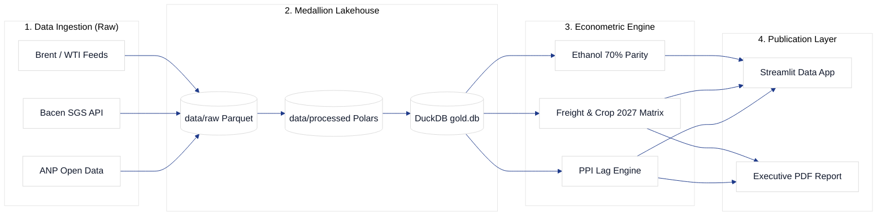

# GasAnalytics — Oil, Fuel & Crop 2027 Econometric Intelligence

> **Open-source analytical platform for modeling fuel price lags (PPI) across presidential election cycles and simulating freight costs and operating margins for Brazilian agribusiness (Crop 2026/2027).**

[](https://www.python.org/)
[](https://github.com/astral-sh/uv)
[](https://duckdb.org/)
[](LICENSE)

---

## 🌾 Strategic Overview

In presidential election years in Brazil, fuel prices (Gasoline C and Diesel S10) historically exhibit artificial compression relative to the international Import Parity Price (PPI), frequently followed by sharp post-election adjustments.

**GasAnalytics** is an enterprise-grade econometric research and data pipeline that:
1. Ingests and normalizes public time-series data from the **ANP** (fuel pump & distribution prices 2014–2026), **Central Bank of Brazil (Bacen SGS)** (USD/BRL exchange rates and IPCA inflation), and global benchmarks (**Brent & WTI Crude Oil**).
2. Quantifies the structural lag curve before and after the 2014, 2018, and 2022 election cycles, providing predictive bounds for the **2026 election and 2027 transition**.
3. Evaluates freight elasticity and projects margin compression for grain producers (soybeans and corn) across major logistics corridors connecting Mato Grosso, Goiás, and Rio Grande do Sul to export ports (Santos, Paranaguá, Rio Grande, Barcarena).
4. Models the 70% ethanol-to-gasoline pump parity and sugar mill allocation decisions (Sugar vs. Hydrous Ethanol).

---

## 🏛️ Medallion Architecture



---

## 🚀 Quick Start

### Prerequisites
- [uv](https://github.com/astral-sh/uv) (fast Python package manager)

```bash
# Clone the repository
git clone https://github.com/LucianoTeixeiras/gas-analytics.git
cd gas-analytics

# Install dependencies and sync virtual environment
uv sync

# Run tests
uv run pytest
```

---

## 📋 Canonical Prompt Catalog

This repository follows the **Issue-as-a-Prompt** governance standard established in the portfolio. Every development work order is versioned under `docs/prompts/`:

- [Prompts Catalog README](docs/prompts/README.md)
- [Architecture Epics (GAS-1 to GAS-5)](docs/prompts/epicos/)
- [Executable Tasks (GAS-6 to GAS-16)](docs/prompts/tasks/)

---

## 👤 Author & Architecture
Developed by **Luciano Teixeira** — Applied AI & Data Architecture.
