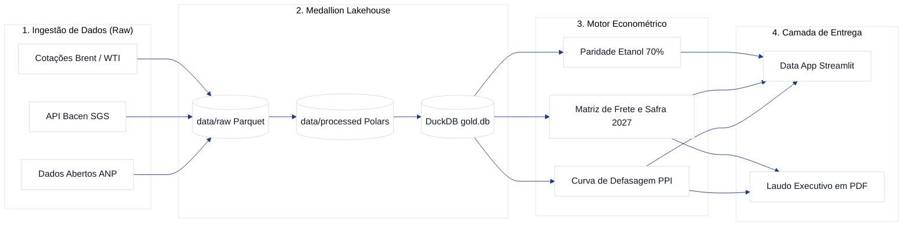

# GasAnalytics — Inteligência Econométrica de Petróleo, Combustíveis e Safra 2027

> **Plataforma analítica open-source para modelagem de defasagem de preços de combustíveis (PPI) em ciclos eleitorais e simulação de custos de frete e margem operacional do agronegócio brasileiro (Safra 2026/2027).**

[](https://www.python.org/)
[](https://github.com/astral-sh/uv)
[](https://duckdb.org/)
[](LICENSE)

---

## 🌾 Visão Estratégica

Em anos eleitorais presidenciais no Brasil, os preços dos combustíveis (Gasolina C e Óleo Diesel S10) historicamente sofrem represamento em relação ao Preço de Paridade de Importação (PPI) internacional, com recomposições expressivas no período pós-eleição.

O **GasAnalytics** é uma esteira de dados e pesquisa econométrica que:
1. Ingere e normaliza séries temporais públicas da **ANP** (preços semanais de distribuição e bomba de 2014 a 2026), **Banco Central do Brasil (Bacen SGS)** (câmbio comercial USD/BRL e IPCA) e cotações internacionais (**Petróleo Brent e WTI**).
2. Modela a curva de defasagem estrutural em janelas pré e pós-eleitorais nos ciclos de 2014, 2018 e 2022, projetando balizadores para a **eleição de 2026 e transição de 2027**.
3. Cruza a elasticidade do diesel com o frete rodoviário de grãos (soja e milho) dos polos produtores (Mato Grosso, Goiás e Rio Grande do Sul) até os portos exportadores (Santos, Paranaguá, Rio Grande e Barcarena), projetando a compressão da margem líquida da **Safra 2026/2027**.
4. Modela a paridade energética dos 70% entre Etanol Hidratado e Gasolina C e o mix de moagem das usinas (Açúcar x Etanol).

---

## 🏛️ Arquitetura Medalhão Local



---

## 🚀 Como Executar

### Pré-requisitos
- [uv](https://github.com/astral-sh/uv) instalado no sistema.

```bash
# Clonar o repositório
git clone https://github.com/LucianoTeixeiras/gas-analytics.git
cd gas-analytics

# Sincronizar o ambiente virtual e dependências
uv sync

# Executar os testes unitários
uv run pytest
```

---

## 📋 Catálogo de Prompts Canônico

O projeto segue compulsoriamente a governança **Issue-as-a-Prompt** derivada do padrão *Tá na Lista*. Todas as ordens de serviço e prompts de agentes estão versionados fisicamente sob `docs/prompts/`:

- [README do Catálogo de Prompts](docs/prompts/README.md)
- [Prompts de Arquitetura dos Épicos (GAS-1 a GAS-5)](docs/prompts/epicos/)
- [Ordens de Serviço das Tarefas (GAS-6 a GAS-16)](docs/prompts/tasks/)

---

## 👤 Autor & Arquitetura
Desenvolvido por **Luciano Teixeira** — Engenharia de IA Aplicada & Arquitetura de Dados.
