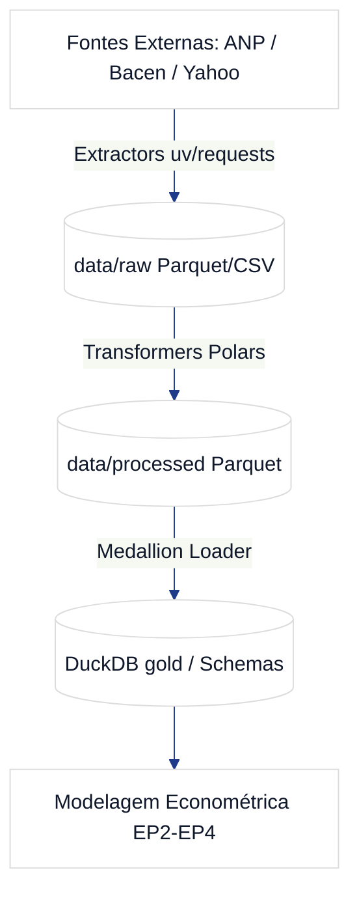

# GAS-1 — EP1: Infraestrutura Analítica & Ingestão de Séries Temporais (ANP / Bacen / Yahoo)

**Tipo:** Épico  
**Status no Jira:** Em Andamento  
**Projeto:** GAS (GasAnalytics — Petróleo, Combustíveis & Safra 2027)  
**Papéis:** Arquiteto / Revisor: **Luciano Teixeira** | Orquestrador: `Hermes Agent` | Executores: `Antigravity` / `Hermes`  
**Data:** 2026-11-01  

---

## 1. Contexto & Visão de Negócio
O objetivo do **EP1** é estabelecer os alicerces analíticos do projeto **GasAnalytics**, criando um repositório Python moderno governado por `uv`, uma camada de dados local Lakehouse Medallion orientada a DuckDB e conectores resilientes para as séries históricas da ANP (combustíveis no Brasil), Banco Central (taxas de câmbio USD/BRL e índices de inflação) e cotações internacionais (Brent e WTI).

## 2. Fronteiras de Arquitetura & Stack
- **Linguagem & Ambiente:** Python 3.12 gerenciado exclusivamente via `uv`.
- **Motor de Dados:** DuckDB (in-memory e arquivo persistente `data/gold/gas_analytics.duckdb`).
- **Formato de Armazenamento:** Parquet particionado com compressão Snappy.
- **Fontes de Dados:**
  - ANP Dados Abertos (Gasolina Comum, Gasolina Aditivada, Óleo Diesel S10, Óleo Diesel S500, Etanol Hidratado).
  - Banco Central do Brasil (SGS - Séries 1, 10813, 433).
  - Yahoo Finance / Fed FRED (Petróleo Brent e WTI em USD/barril).

## 3. Tarefas Subordinadas
1. **GAS-6:** Setup do Repositório gas-analytics com uv, DuckDB e PyProject.
2. **GAS-7:** Extrator de Séries Históricas da ANP (Gasolina C e Diesel S10).
3. **GAS-8:** Conector de Séries Macroeconômicas (Bacen SGS, Câmbio USD/BRL e Brent/WTI).
