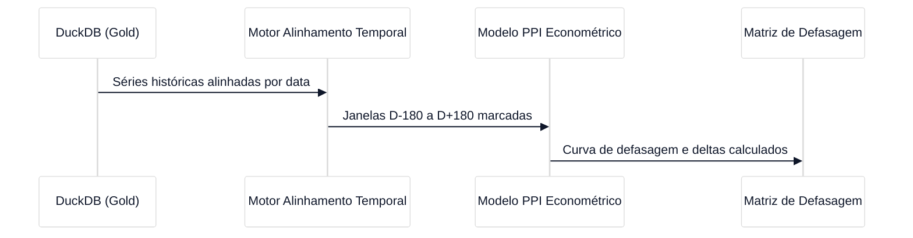

# GAS-2 — EP2: Modelagem Econométrica: Ciclos Eleitorais x Defasagem de Combustíveis

**Tipo:** Épico  
**Status no Jira:** Backlog  
**Projeto:** GAS (GasAnalytics — Petróleo, Combustíveis & Safra 2027)  
**Papéis:** Arquiteto / Revisor: **Luciano Teixeira** | Orquestrador: `Hermes Agent` | Executores: `Antigravity` / `Hermes`  
**Data:** 2026-11-01  

---

## 1. Contexto & Visão de Negócio
O **EP2** investiga a hipótese central da pesquisa: em anos eleitorais presidenciais brasileiros (ciclos de 2014, 2018, 2022 e o ciclo prospectivo de 2026/2027), os preços dos combustíveis (Gasolina e Diesel) sofrem represamento artificial e ampliação de defasagem em relação ao Preço de Paridade de Importação (PPI), seguido por reajustes compensatórios no período pós-eleitoral.

## 2. Fronteiras de Arquitetura & Modelagem
- **Janelas Temporais:** 180, 90 e 30 dias pré-eleição (1º e 2º turnos) vs. 30, 90 e 180 dias pós-posse.
- **Métricas Chave:**
  - Defasagem Nominal (R$/L) = Preço Médio Refinaria Brasil - Preço Teórico PPI.
  - Defasagem Percentual (%) = (Preço Brasil / Preço PPI - 1) * 100.
  - Testes de quebra estrutural e cointegração das séries temporais.

## 3. Tarefas Subordinadas
1. **GAS-9:** Motor de Alinhamento Temporal: Marcação de Janelas Pré e Pós-Eleitorais.
2. **GAS-10:** Cálculo da Curva de Defasagem PPI (Preço de Paridade de Importação).
