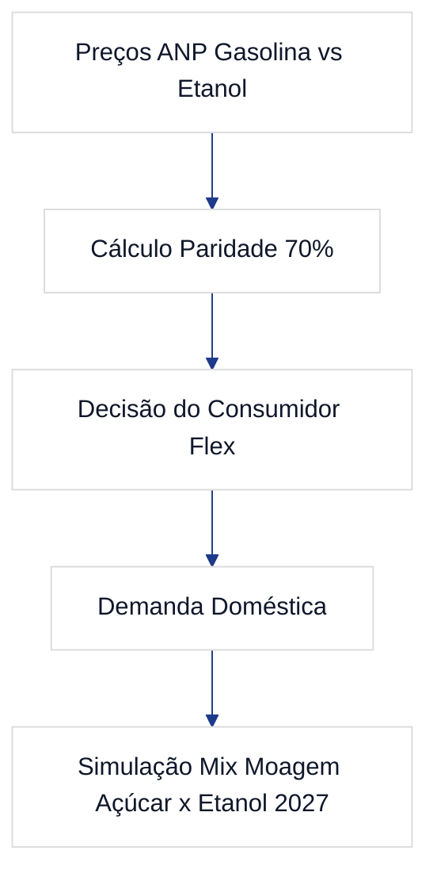

# GAS-4 — EP4: Complexo Sucroalcooleiro & Paridade Etanol x Gasolina

**Tipo:** Épico  
**Status no Jira:** Backlog  
**Projeto:** GAS (GasAnalytics — Petróleo, Combustíveis & Safra 2027)  
**Papéis:** Arquiteto / Revisor: **Luciano Teixeira** | Orquestrador: `Hermes Agent` | Executores: `Antigravity` / `Hermes`  
**Data:** 2026-11-01  

---

## 1. Contexto & Visão de Negócio
O **EP4** avalia a dinâmica competitiva entre o Etanol Hidratado e a Gasolina C nas bombas com base na paridade energética dos 70%, analisando como o represamento da gasolina afeta a rentabilidade das usinas e direciona o mix de moagem de cana-de-açúcar (açúcar x etanol) para a safra 2026/2027.

## 2. Fronteiras de Arquitetura & Stack
- **Regiões Analisadas:** São Paulo, Minas Gerais, Goiás, Mato Grosso e Paraná (principais polos produtores).
- **Métricas:** Razão Preço Etanol / Preço Gasolina, margem de equivalência ATR (Açúcar Total Recuperável) entre açúcar VHP no mercado internacional e etanol hidratado/anidro doméstico.

## 3. Tarefas Subordinadas
1. **GAS-13:** Análise da Paridade dos 70% Etanol x Gasolina nos Estados Produtores.
2. **GAS-14:** Simulação de Mix de Moagem das Usinas (Açúcar x Etanol) para a Safra 2027.
