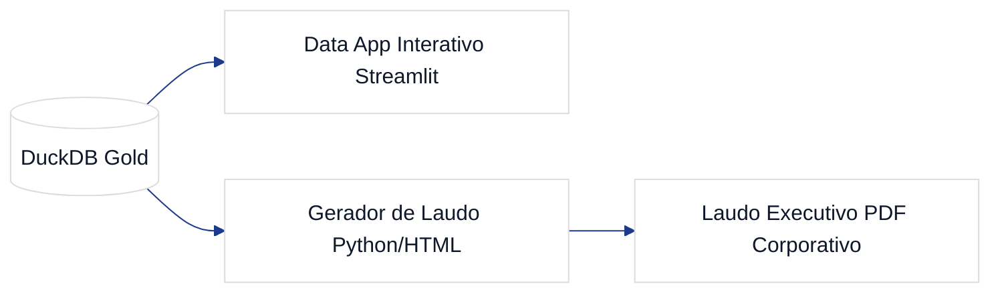

# GAS-5 — EP5: Camada de Publicação: Data App & Laudo Executivo de Sensibilidade

**Tipo:** Épico  
**Status no Jira:** Backlog  
**Projeto:** GAS (GasAnalytics — Petróleo, Combustíveis & Safra 2027)  
**Papéis:** Arquiteto / Revisor: **Luciano Teixeira** | Orquestrador: `Hermes Agent` | Executores: `Antigravity` / `Hermes`  
**Data:** 2026-11-01  

---

## 1. Contexto & Visão de Negócio
O **EP5** consolida as entregas analíticas e visuais do GasAnalytics em dois produtos finais de alto impacto para o portfólio: um **Data App interativo** para exploração dinâmica de cenários e um **gerador automatizado de laudo executivo em PDF corporativo** (fundo branco, tabelas executivas, gráficos de sensibilidade e diagramas limpos).

## 2. Fronteiras de Arquitetura & Stack
- **Data App:** Streamlit ou FastHTML acoplado diretamente às views analíticas do DuckDB.
- **Laudo Executivo:** Relatório HTML/CSS corporativo renderizado para PDF via Edge Headless, em conformidade com as diretrizes visuais do portfólio.

## 3. Tarefas Subordinadas
1. **GAS-15:** Construção do Data App Interativo GasAnalytics (Streamlit + DuckDB).
2. **GAS-16:** Gerador de Laudo Econométrico Executivo em PDF Corporativo.
